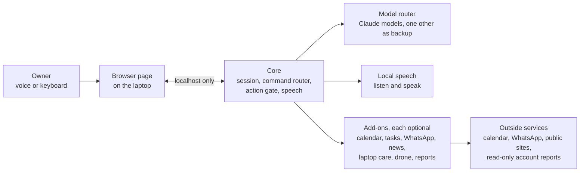

# Design decisions and guardrails

This page is the public view of how Khadijah is put together. The program itself isn't published; the design is open.

## The shape

A small core does what every version needs: serve the page, hold the conversation, call a model, speak, listen, log, keep data. Everything else is an add-on that joins through the core's registration points only.

## Design decisions

| Decision | Why |
|---|---|
| **One owner, one laptop.** No cloud hosting, no second user, no phone app. | It removes most of the security surface. What is not built cannot be attacked. |
| **A small core and optional add-ons.** The core never imports an add-on. | An add-on can fail or be switched off without taking the rest down. |
| **Local first.** Anything that can run on the laptop does: speech to text, text to speech, the server, the data. | Data leaves the laptop only to a short list of named services, and only for what is needed. |
| **Answer fixed commands without a model.** A command router handles them before any model is asked. | It is faster, free, and always gives the same answer. |
| **Route to the right model.** Three selectable models, an upgrade cap, fallbacks if one fails, and the cheapest model for small helper jobs. | Cost and speed stay predictable, and a failed model does not stop her. |
| **Fail safe and fail quiet.** A failed source shows a plain reason and never blanks the others. | One broken feed should never take the screen down. |
| **Read only by default.** Add-ons that touch money, files or the network observe first. Any change needs a preview and a confirmation. | A mistake costs a preview, not data. |
| **Ports are settings, never fixed in code.** | Nothing about the setup is baked in. |

## Guardrails: what she can never do, and how the structure enforces it

- **She listens on the laptop only.** The server accepts local connections only and refuses state-changing requests that come from other web pages.
- **An action gate.** The only way a model's reply can cause an action is a short list: search, open an approved link, look at a screen, check for patches, read the calendar. Anything else is refused.
- **She asks before she looks.** Looking at a screen needs the owner's consent first, and the program, not the model, asks which screen.
- **She never trades or buys.** Account reports are read-only. An automated check fails the build if any code could place or cancel an order.
- **Secrets stay out of the code.** Keys and tokens live in the Windows credential store, never in code, logs or the page. She never stores a website password.
- **Audio stays in memory.** Microphone clips are not written to disk.
- **Changes need two yeses.** The storage cleaner shows a preview, the owner ticks what to clean, confirms twice, and only then deletes.
- **Updates are safe.** A security-patch install checks everything that depends on the package, runs her whole test suite, and puts every saved version back if anything fails.
- **Untrusted text stays untrusted.** News headlines and web text are never followed as instructions.

## What this shows

Designing the structure so the rules are enforced, not just promised, is the part of AI work that matters most when the system acts on someone's real life. The architecture was written against the standards listed in [ENGINEERING.md](ENGINEERING.md) and reviewed against a quality model that includes safety.
