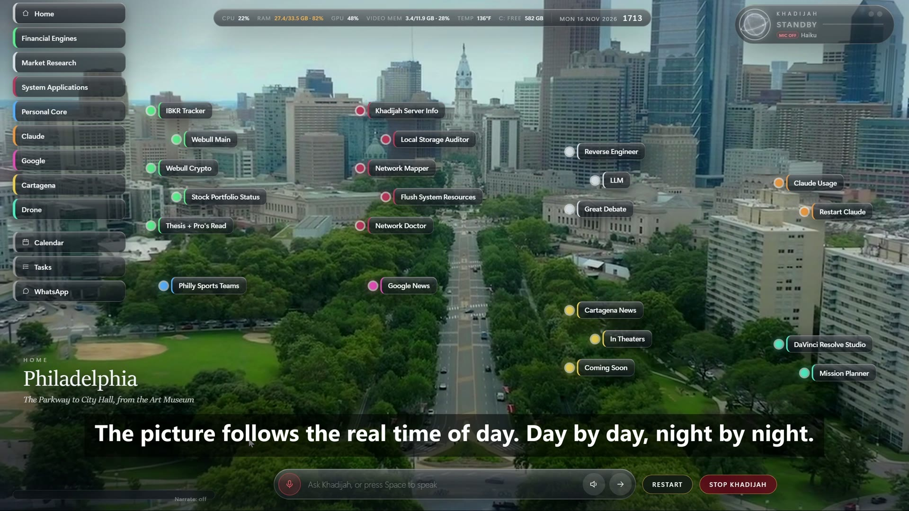
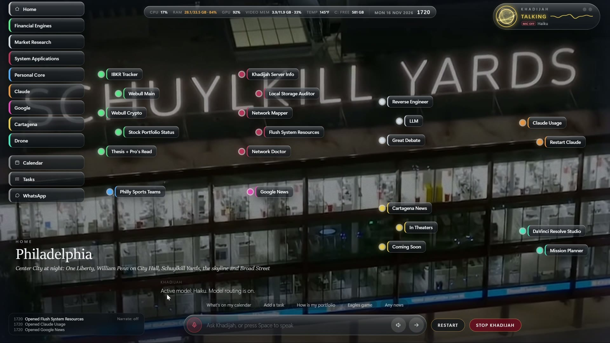
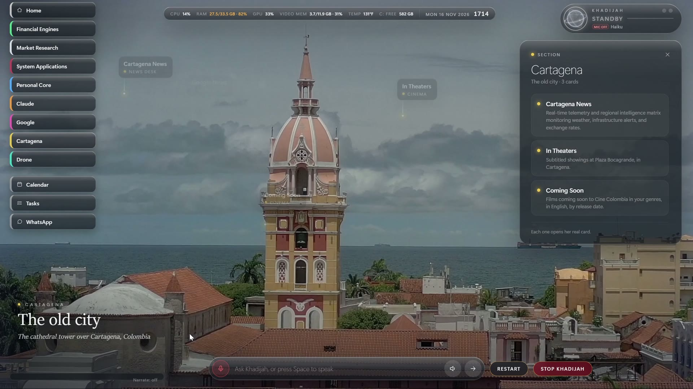

# Khadijah

**A private, voice-driven AI assistant for one Windows laptop.**
Designed and directed by Rafiq. Built with Claude.

> [!NOTE]
> **This is the public page.** The program itself isn't published. This page shows what she does, how she was designed and how the project was run. Hiring, or want something like this built? [Email me](mailto:rkmaerial@gmail.com).

**[Watch the 4-minute demo on YouTube](https://youtu.be/412THofH7Jc)**: a tour of her screen, The City. She answers in English, Spanish and Portuguese, reads the weather, the calendar and the tasks, and tells you which AI model she is using.

-brightgreen)

---

## At a glance

| | |
|---|---|
| **What** | A voice assistant that listens, answers in the language you use, and runs 78 features in 11 groups: calendar and tasks, WhatsApp, news, laptop care, drone and video helpers, read-only account reports. [Every feature is listed here](FEATURES.md) |
| **Role** | Architect and product owner: vision, requirements, design decisions, standards, sign-off. Claude wrote the code under written rules |
| **Scale** | About 130,000 lines of Python and JavaScript (72,000 of program, 58,000 of tests), 191 test files, 4,200+ automated tests |
| **Process** | 700+ written requirements, 900+ test cases, 200+ recorded decisions, checks on every change. Industry standards used as references |
| **Safety** | Local-only server, an action gate that lets a model reply do only a short list of things, read-only by default, a person confirms anything that changes something |
| **Status** | Working daily. 900+ changes in the 17 days of this rebuild (1 to 17 November 2026) |

## What I bring

- **I turn a vision into a tested system.** Written requirements, a test for each, and nothing called finished until it has been shown to work.
- **I direct AI to build, and I hold it to a standard.** The work is specified, checked and recorded, so an AI assistant can build at speed without the quality drifting.
- **I design for safety from the first day.** One owner, one laptop, private by default, and rules that the structure enforces, not just promises.
- **I catch what the AI gets wrong.** A reviewed demo found two wrong answers; both were written down, tested and fixed or removed. See [ENGINEERING.md](ENGINEERING.md).

## What she is

Khadijah is a personal assistant you talk to. She answers in a voice made on the laptop she runs on, in whatever language you write or speak, and shows what she is doing on a screen in the browser.

- **Voice in, voice out.** Speech to text and text to speech run on the laptop.
- **A router for the right model.** Fixed commands are answered at once without a model. Everything else goes to a chosen model, with fallbacks, caps and a cheaper model for small jobs.
- **Private by design.** One owner, one laptop. Her server listens on that laptop only and refuses requests from other web pages. She never places a trade, never buys anything and never stores a website password.
- **A screen that looks finished: The City.** Real footage of a place for each part of her, following the real time of day. A menu down the left, a strip of live readings across the top, her pill at the upper right and a message bar at the bottom. Each name on the picture opens a live tool.

## How she is built, and how it was run

- **[DESIGN.md](DESIGN.md)**: the architecture diagram, the design decisions and the guardrails.
- **[ENGINEERING.md](ENGINEERING.md)**: the process, the standards used as references, the numbers and two real examples of a wrong answer being caught and fixed.
- **[FEATURES.md](FEATURES.md)**: everything she does today, group by group.

| | |
|---|---|
| Written requirements | 700+ |
| Test cases | 900+ |
| Automated tests | 4,200+ |
| Recorded decisions | 200+ |
| Features | 78, in 11 groups |
| User guide | 23 pages, included here in [`docs/guide`](docs/guide) |
| History of this rebuild | 900+ changes, 1 to 17 November 2026 |

## The City

| | |
|---|---|
|  |  |
|  |  |

## About the builder

I'm Rafiq, founder of RKM Aerial. I design and direct software: a clear vision, written requirements, a test for every one, and nothing called finished until it is shown to work.

- **Contact:** [rkmaerial@gmail.com](mailto:rkmaerial@gmail.com)
- **The program isn't published.** This page and the guide are the public side of the project.

## Licence

All rights reserved. This page is for viewing. See [LICENSE](LICENSE).
