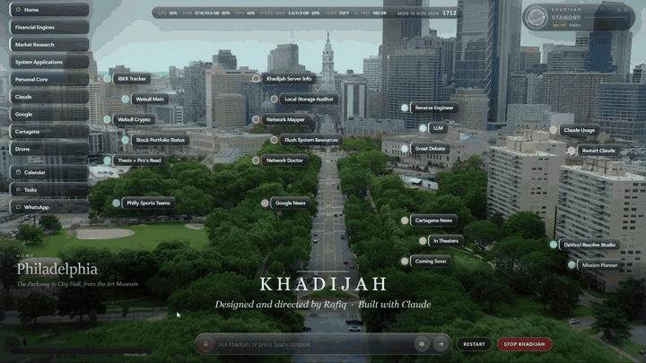
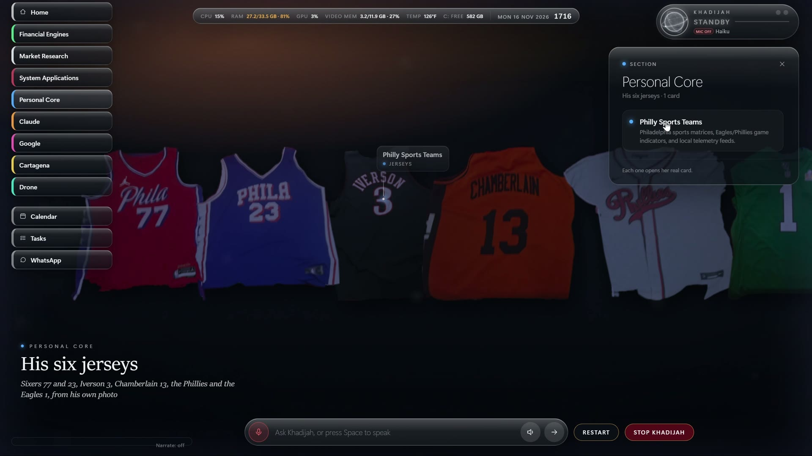

# Khadijah

**A private, voice-driven AI assistant with a safety gate between the model and your life: 78 features, 700+ written requirements, 4,000+ automated tests.**

Designed and directed by Rafiq. Built with Claude.

> [!NOTE]
> **This is the public page.** The program itself is not published. This page shows what she does, how she was designed and how the project was run. Hiring, or want something like this built? [Email me](mailto:rkmaerial@gmail.com).

**[Watch the 4-minute demo on YouTube](https://youtu.be/412THofH7Jc)**: a tour of her screen, The City. She answers in English, Spanish and Portuguese, reads the weather, the calendar and the tasks, and tells you which AI model she is using.

-brightgreen)

---

## Why this project matters

Most AI demos show a model answering a question. Khadijah is the harder problem: an assistant that lives on one person's laptop, can reach their calendar, tasks, messages and screen, and must stay safe, predictable and affordable while it does.

She was begun on 2 October 2026 and rebuilt from a clean start on 1 November under a full engineering process: every requirement written down first, a test for each, every change recorded, and nothing called finished until it was shown to work. That rebuild alone holds 900+ recorded changes in 17 days (1 to 17 November 2026).

## What this demonstrates

| Skill | Evidence in this project |
|---|---|
| **Designing AI systems** | A command router answers fixed commands instantly without a model. Everything else goes to a model router with three selectable models, an upgrade cap, fallbacks if one fails, and the cheapest model for small helper jobs. Cost and speed stay predictable. |
| **Agent safety by structure** | An action gate: the only way a model's reply can cause an action is a short list (search, open an approved link, look at a screen, check for patches, read the calendar). Anything else is refused. She asks before she looks at a screen, and the program, not the model, asks which one. This is her defence against prompt injection: a model that is fooled by hostile text it reads, such as a web page or a message, still cannot do anything outside that list. |
| **Privacy by design** | One owner, one laptop. The server listens on that laptop only and refuses requests from other web pages, which closes the usual route for a hostile page to read her data. She never places a trade, never buys anything and never stores a website password. Read-only by default; a person confirms anything that changes something. |
| **Requirements and verification** | 700+ written requirements, 900+ test cases and 4,000+ automated tests. Each requirement has a test written before the build and seen failing. Each build is reviewed by a separate AI reviewer, given only the specifications and the code. |
| **Directing AI to build, and holding it to a standard** | Claude wrote the code under written rules. The work is specified, checked and recorded, so an AI assistant can build at speed without quality drifting. A reviewed demo found two wrong answers; both were written down, tested and fixed or removed ([ENGINEERING.md](ENGINEERING.md)). |
| **Multilingual local voice** | Speech to text and text to speech run on the laptop. She answers in the language you write or speak. |
| **Product and interface design** | The City: real footage of a place for each part of her, following the real time of day, with each name on the picture opening a live tool. |

## At a glance

| | |
|---|---|
| **What** | A voice assistant that listens, answers in the language you use, and runs 78 features in 11 groups: calendar and tasks, WhatsApp, news, laptop care, drone and video helpers, read-only account reports. [Every feature is listed here](FEATURES.md) |
| **Role** | Architect and product owner: vision, requirements, design decisions, standards, sign-off. Claude wrote the code under written rules |
| **Scale** | About 120,000 lines of code (about 64,000 of program, 59,000 of tests), 4,000+ automated tests |
| **Process** | 700+ written requirements, 900+ test cases, 200+ recorded decisions, checks on every change |
| **Standards** | Used as references: ISO/IEC/IEEE 12207, 29148, 42010, 29119; ISO/IEC 25010, 29110, 5055; PEP 8 and 257; Semantic Versioning; Keep a Changelog; Conventional Commits. [Details](ENGINEERING.md) |
| **Status** | Working daily. 900+ changes in the 17 days of the rebuild (1 to 17 November 2026) |

## Architecture

A small core serves the page, holds the conversation, calls a model, speaks, listens, logs and keeps data. Everything else is an add-on that joins through the core's registration points, so no feature reaches into another. [DESIGN.md](DESIGN.md) has the architecture diagram, the design decisions and the reason for each.

- **Local first.** Anything that can run on the laptop does: speech to text, text to speech, the server, the data. Data leaves the laptop only to a short list of named services: the AI models, the sites and accounts she reads, and, in Chrome, the browser's own speech recognizer, which only notices that someone is talking (the words come from Whisper on the laptop).
- **Fixed commands without a model.** Faster, free and always the same answer.
- **Rules enforced by structure, not promised.** The action gate, the consent step and the local-only server are code paths a model's reply cannot talk its way around.
- **A separate tool stays separate.** Her Network Doctor card runs my standalone checker, [Network Doctor](https://github.com/rafiqkmateen/network-doctor) (a showcase page; its code is private), and shows the result. Its check only reads; a fix runs only when I press that fix's button on the card. She never depends on it: when it is missing, the card says so.

## Quality and process

1. A requirement is written in plain words and numbered.
2. A test for it is written first and seen failing.
3. The feature is built.
4. A separate reviewer checks it against the requirement, using only the sources.
5. It is shown to work, and the result is recorded.
6. The change, the decision and the version are logged.

[ENGINEERING.md](ENGINEERING.md) holds the process, the standards, the numbers and two real examples of a wrong answer being caught and fixed.

## Stack

Python 3.14 · FastAPI · Uvicorn · WebSockets · Anthropic Claude models (with one backup model) · faster-whisper with CTranslate2 (speech to text) · PyTorch (text to speech) · JavaScript front end · Playwright · pytest · ruff · pip-audit

## The City

| | |
|---|---|
|  |  |
|  |  |

## Documents on this page

| | |
|---|---|
| [DESIGN.md](DESIGN.md) | Architecture diagram, design decisions and guardrails |
| [ENGINEERING.md](ENGINEERING.md) | Process, standards used as references, numbers, two caught errors |
| [FEATURES.md](FEATURES.md) | Everything she does today, group by group |
| [`docs/guide`](docs/guide) | The 23-page user guide |

## About the builder

I'm Rafiq, founder of RKM Aerial. I design and direct software: a clear vision, written requirements, a test for every one, and nothing called finished until it is shown to work. I am looking for AI implementation, AI security and AI automation roles, and I can build something like this for you.

- **Contact:** [rkmaerial@gmail.com](mailto:rkmaerial@gmail.com)
- **The program isn't published.** This page and the guide are the public side of the project.

## Licence

All rights reserved. This page is for viewing. See [LICENSE](LICENSE).

---

*Page owner: Rafiq. Page version 2.1.0, 2026-11-19.*
