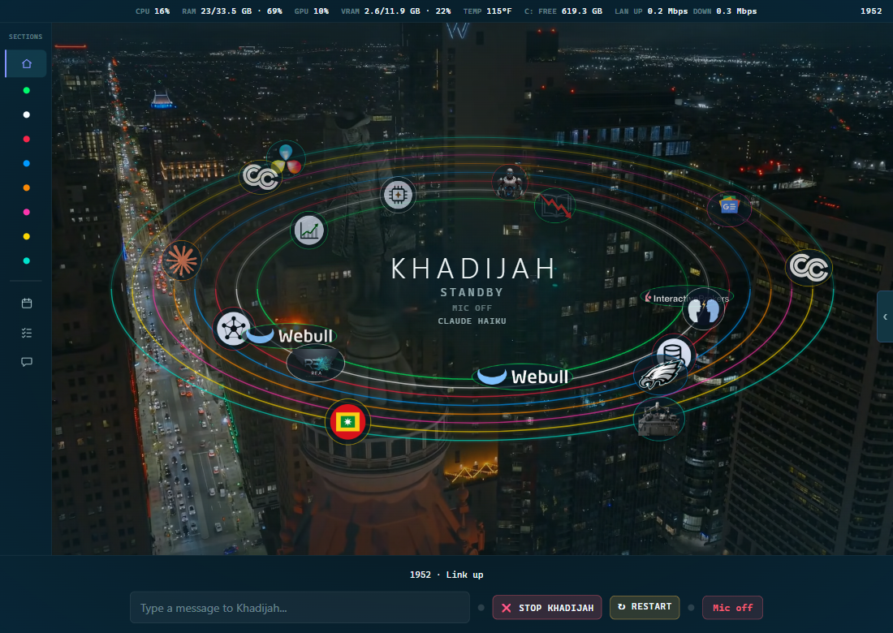

# What you see on the screen

Purpose: name each part of the screen and say what it does, so you always know where to look.
Owner: Rafiq. Version 0.7.0 (0.7.0: the cards float and flip, and one leans, 2026-11-12; 0.6.1: the network speed box was taken off the top strip, 2026-11-11; 0.6.0: agreed by Rafiq, 2026-11-04; Escape now says it stops her reply; 2026-11-03: calm glow added, not yet agreed; 0.2.0 was agreed by Rafiq, 2026-11-02; pictures of Home, the folded panel and the red glow were added after, not yet agreed). Date: 2026-11-12.

The screen is one dark Chrome window. It has four places: a menu on the left, a stage in the middle, a panel on the right, and a bar along the bottom. A strip runs across the top.

## The menu (left)

The menu lists the parts of the screen. Click a name to open it. The part you are in is highlighted.

- **Home** is the first screen. Her name sits in the middle of thin rings.
- **Eight groups** come next, each with a coloured dot: Financial Engines, Market Research, System Subsystems, Personal Core, Claude, Google, Cartagena and Drone. Each group holds a few tools, shown as small logos.
- **Calendar, Tasks and WhatsApp** sit below a thin line.

When something new arrives for a part, its name blinks slowly until you open it.

The Welcome page lists what works today and what has not been tried for real yet. If you click a tool and nothing happens, read **Problems and fixes**.

## The stage (middle)

- **Home** shows her name and her state in the middle of the rings. The state is one of STANDBY, LISTENING, THINKING or TALKING. It reads OFFLINE when the server is not answering, and VOICE NOT READY while her voice is still loading. Under it, MIC OFF tells you the microphone is off, and the model line says which AI is answering.
- **A group** shows a list of its tools on the left and a tile for each one.
- **Calendar** shows a month. Today has an outline.
- **Tasks** shows your open tasks.

## The cards

When you open a tool, its card opens beside it. Every card floats a little, with a soft shadow and a lit edge, and it flips into view when it opens. The text stays level so it stays sharp. Only the Philly Sports Teams card also leans toward the pointer, up to 12 degrees, with a light sheen. A card that holds a map does not grow under the pointer.

To turn all of this off, add `?flat=1` to the end of the page address, or switch on "reduce motion" in Windows. The cards then open flat.

## The top strip

The strip shows how hard the laptop is working: the processor, memory, graphics, graphics memory, graphics temperature, and free space on drive C. The date and time are at the right end.

A number turns amber and then red when it stays high for a while. It goes back as soon as it drops.

## The right panel

- **Her face.** A short video of her, or a glowing sphere. Press **G** to switch.
- **Her name and her state** are under her face: for example STANDBY, LISTENING, THINKING or TALKING. The line below shows which AI answered last, for example CLAUDE HAIKU. Her answers are spoken. They are not written here.
- **Narrate.** A switch at the top. When it is on, she says one short line when you open a part.
- **The Open box** at the bottom shows the tool that is open.

If your window is narrower than 1200 pixels, the panel starts folded. Click the small handle at the right edge to open it. You can fold it again with the button at the top of the panel.

## The bottom bar

- **The message box.** Type here and press Enter.
- **STOP KHADIJAH.** Shuts her down.
- **RESTART.** Shuts her down and starts her again.
- **Two small lights.** One shows when something new has come in. The other shows when she is listening.
- **The Mic button.** Red and "Mic off" when the microphone is off.

Above the bar, the newest four events are listed with their times, for example "You: What is two plus two?", "Mic on" or "Link lost". They show what you said. They never show her answer.

## The glow round the edges

A soft colour glow shows around the screen. Normally it is a calm colour, dimmer while the microphone is off, and talking does not change it. It is red when she loses her connection to the server, or when a reply fails. A green glow pulses when a WhatsApp message comes in.

## Keys

| Key | What it does |
|---|---|
| **M** | Turns the microphone on or off. It is off every time the page opens. |
| **G** | Switches her between face and sphere. |
| **Escape** | Stops her reply. |
| **Up and Down arrows** | Move through the menu. |

The M and G keys do not work while the cursor is in the message box.
