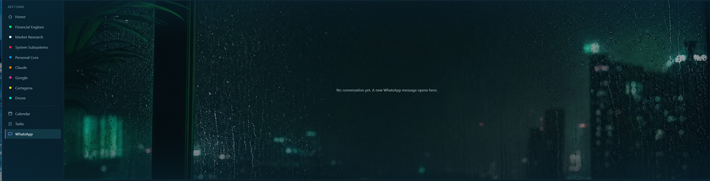

# WhatsApp

Purpose: show you how to connect WhatsApp, read messages, and reply.
Owner: Rafiq. Version 0.4.0 (0.4.0: agreed by Rafiq 2026-11-03; 0.3.1: more pictures added 2026-11-02). Date: 2026-11-03.

She shows your WhatsApp chats on one screen. You read each message there and type your replies there. She never answers a message for you.

Rafiq paired the new app, then saw a message arrive, a typed reply sent from the card, a voice note, and a translated message all work (his word, 2026-11-02).

## Turn it on and connect your phone

You do this once.

1. Open `data\config.json` in Notepad. Set `"whatsapp_enabled": true`. Save it.
2. Restart her.
3. Open `http://localhost:8340/wa/pair` in Chrome. A code appears.
4. On your phone, open WhatsApp. Go to Linked devices, and scan the code.

**What you should see:** the health line says "Connected to WhatsApp."

Only one app should be connected to your WhatsApp at a time. Keep the older assistant's WhatsApp off while this one is on.

## Read a message

When a message comes in, a green glow pulses at the edge of the screen. Click **WhatsApp** in the menu, the last item on the left.

- The chats are listed on the left. Each row shows the person, the last line, the time, and a green count of messages you have not read.
- Click a row to open that chat. The messages are on the right. Theirs are on the left side, yours on the right.

- Opening the WhatsApp screen counts the chat you see as read. Other chats keep their counts until you click them.
- She holds the 20 newest chats. If a 21st person writes, the chat that has been quiet longest leaves the list.
- A reload of the page empties the list. A message that arrived while no page was open is shown when a page connects.

She does not read a message aloud and does not ask the AI about it.

## Send a reply

1. Click the chat.
2. Click the reply box under it. It says "Reply to" and the name.
3. Type your reply in English. Press Enter, or click Send.

**What you should see:** your words appear as a bubble on the right, and the dock says "WhatsApp: reply sent".

- A small count by the box shows how many letters you used out of 4000.
- If the reply could not be sent, your text comes back into the box and the box turns red. Nothing you typed is lost.
- Only this box sends a message. The microphone and the main message box never do, so something said near her cannot message anyone.

## Messages in another language

- A message that is not in English shows in English.
- When you reply, she translates your English into the language that person writes in. Your bubble still shows your English.
- In the chat's header, after the name, a label says which language replies go out in, for example "Replies: Spanish (auto)". "Auto" means she learned it from what the person wrote. It lasts 24 hours after their last message.
- To set it yourself, click the pencil by the label and type a language name. Type "English" for no translation. Type "Auto" to let their messages decide again.
- If a translation takes more than 8 seconds, she shows the original words, or sends your English as typed. The message is never lost.

## Voice notes

A voice note shows as "[Voice note]" and then the words, in English. She writes the words out on this laptop, so the sound never leaves it. Only the words go to the translator.

- A short note takes a few seconds. Notes that arrive together are done one at a time.
- If nothing was said, it shows "[Voice note] (no speech heard)".
- If the words cannot be written, you see only "[Voice note]".
- A note longer than five minutes, or bigger than about 6 MB, is not written out.
- The first time, she downloads the listening model. It is about 460 MB.
- To turn this off, set `"wa_voice_transcribe": false` in `config.json`, and restart her.

## Rename a contact

Click the pencil by the name at the top of the chat and type the name you want.

## What she will not do

- She does not send anything by herself, and she does not answer for you.
- She sends only to a chat that has written to you since she started.
- The morning brief is built. It is described on **Morning brief**.

## If something goes wrong

See **Problems and fixes**, under "The WhatsApp light says waiting or down".
