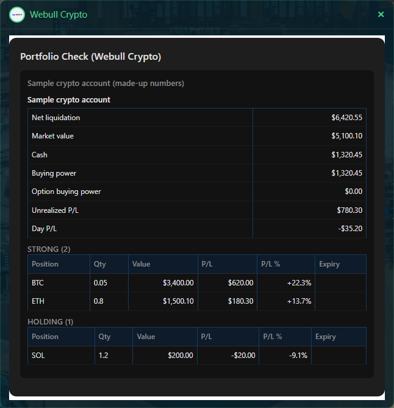
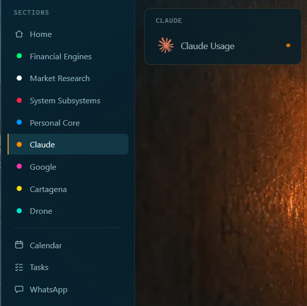
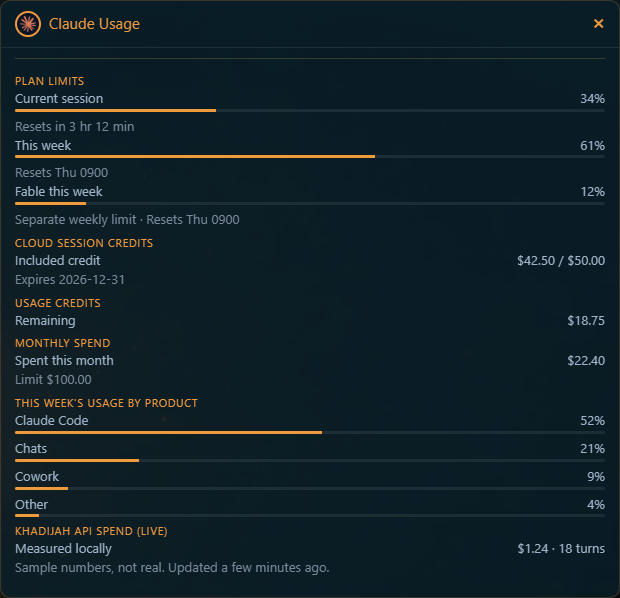

# Webull reports

Purpose: show you how to read your Webull accounts on the Financial Engines screen.
Owner: Rafiq. Version 0.9.3 (0.9.3: made-up sample pictures for Webull Crypto and Claude Usage, 2026-11-09; 0.9.2: the Thesis card seen working as a whole, 2026-11-06; 0.9.1: the Thesis card gets its Webull numbers from Khadijah, 2026-11-06; 0.9.0: agreed by Rafiq 2026-11-03, with three fixes: the three-minute wording, a blank line, the picture moved below step 3; 0.8.1: the Claude Usage picture removed 2026-11-03 because it showed real amounts; pictures added 2026-11-02, the Webull numbers made up). Date: 2026-11-07.

Two reports read your Webull accounts: **Webull Main** and **Webull Crypto**. They only read. Nothing on these screens can buy, sell, change or cancel anything.

Three more cards read through her own hidden Chrome window: **IBKR Tracker**, **Stock Portfolio Status** and, on the Claude screen, **Claude Usage**. They need a one-time sign-in, in **Sign in once for the hidden window**. The fourth, **Thesis + Pro's Read**, runs your own project in Claude.

## Before you start

Your Webull keys must be saved. They are saved once with the key steps in **Add, change or remove a key**. The two names are `webull_app_key` and `webull_app_secret`. They are already saved on this laptop.

## Read a report

1. Click **Financial Engines** in the menu.
2. Click **Webull Main** or **Webull Crypto**.
3. Wait. The card says "Checking your live portfolio... this can take up to a minute."


**What you should see:** a card titled "Portfolio Check (Webull Main)" or "(Webull Crypto)". It shows the balance of each account, then the positions in groups by how well they are doing: Strong, Holding, Weak and Critical. An option that expires within seven days is marked EXPIRING.




How it went on 2026-11-02: Webull Main took about a minute and a half the first time. Webull Crypto took under half a minute. Both showed balances and groups. Neither showed an error.

## Good to know

- The report is a live snapshot. It keeps no history.
- Click the same card again within five minutes and she shows the saved report at once. After five minutes she reads again.
- Only one report runs at a time. After one finishes, wait about twenty seconds before the next.
- A report that takes about three minutes is stopped and says it timed out.
- Account numbers are hidden. You see a label such as "Individual Cash", not the number.
- Webull Crypto shows only your crypto accounts. Webull Main shows the others.
- If one account cannot be read, the rest still show, with a note that says "Partial data".
- No browser is used for these two reports. They do not open a second Chrome window.


## Sign in once for the hidden window

IBKR Tracker, Stock Portfolio Status and Claude Usage read through a hidden Chrome window. It is not your Chrome. It has its own profile, so it needs its own sign-in. It starts only when one of these reads needs it, and it closes after five minutes of no use. You sign in yourself. She never types your password.

1. Stop her first.
2. In a Terminal tab, run this. Keep the tab open until you finish:

```powershell
Start-Process 'C:\Program Files\Google\Chrome\Application\chrome.exe' -ArgumentList '--user-data-dir=C:\Users\you\projects\khadijah\.cache\chrome-profile','--no-first-run','https://claude.ai'
```

3. In that window, sign in to claude.ai. Turn on the Interactive Brokers connector in Settings, then Connectors.
4. Open a new tab, go to the Interactive Brokers site, choose Log In, then Client Portal, and sign in.
5. Close that window. Start her again.

**How you know it worked:** the cards below show data and no sign-in message.

## See or close the hidden window

The hidden window sits off the screen on purpose. Two small scripts let you look at it or close it. They touch only her hidden window, never your Chrome.

1. To bring it onto the screen, run this in a Terminal tab:

```powershell
powershell -File C:\Users\you\projects\khadijah\scripts\powershell\show-hidden-browser.ps1
```

2. To send it back off the screen, add `-Hide` to the same line.
3. To close it, run this:

```powershell
powershell -File C:\Users\you\projects\khadijah\scripts\powershell\stop-hidden-browser.ps1
```

4. If it is not running, the script says "The hidden browser isn't running right now." The window starts only when a card needs it.

Close it only when no card is reading. A read in progress will fail.

**How you know it worked:** the first script says "Brought it on screen." The second says "Hidden browser closed."

## IBKR Tracker and Stock Portfolio Status

1. Click **Financial Engines**, then **IBKR Tracker**.
2. Wait. On 2026-11-02 it took about half a minute.


**What you should see:** "Portfolio Check (today)", your net liquidation, an account summary (cash, stock value, buying power, margin, leverage, profit and loss) and a time-weighted performance table. It says when the data ends, for example "Performance data runs through Fri Oct 30, and there is no live read for today".

**Stock Portfolio Status** puts Webull Main, Webull Crypto and IBKR in one card. On 2026-11-02 it came back in about three seconds; the IBKR part was reused from its saved report.

## Claude Usage

1. Click **Claude** in the menu, then **Claude Usage**.





**What you should see:** plan limits (the current session and this week, with when each resets), cloud session credits, usage credits, monthly spend, and this week's use by product. It took a few seconds on 2026-11-02.

## Thesis + Pro's Read

This card runs your own Thesis project in Claude and shows the report it makes. It needs two addresses, saved one per file in the `conf` folder: `thesis_project.txt` (your Claude project) and `thesis_artifact.txt` (the report page). Without the first, the card is hidden. The files are private and Git does not keep them. Khadijah first reads your Webull accounts herself, through your saved Webull keys, and sends the balances, positions and every order since January 1 of this year (up to 500) inside the message. So your Claude project does not need the Webull connector. If she cannot read them, she sends the old message and the project fetches the numbers itself. Seen working as a whole on 2026-11-06: you pressed the card at 2054 and again at 2128, and the second time the project used the full data and its totals matched Webull exactly. At about 2150 the card showed the report page itself through the app.

1. Click **Financial Engines**, then **Thesis + Pro's Read**.
2. Wait. The card says "this takes a few minutes." On 2026-11-02 it took about 50 seconds.


**What you should see:** "Thesis + Pro's Read — Portfolio Deep-Dive": net liquidation, cash, positions and unrealized profit and loss, then her written read. On 2026-11-02 an amber line at the top said "The report page did not change during this run." That means Claude answered but the report page it keeps was not updated.

## What is not tried yet

- **Saying "portfolio status for this week".** The spoken check is built and tested, and it has not been tried by voice.
- **Failures.** A signed-out hidden window, and the Claude Usage "limit reached" halo, were not seen.

If a report says "data unavailable", see **Problems and fixes**.
