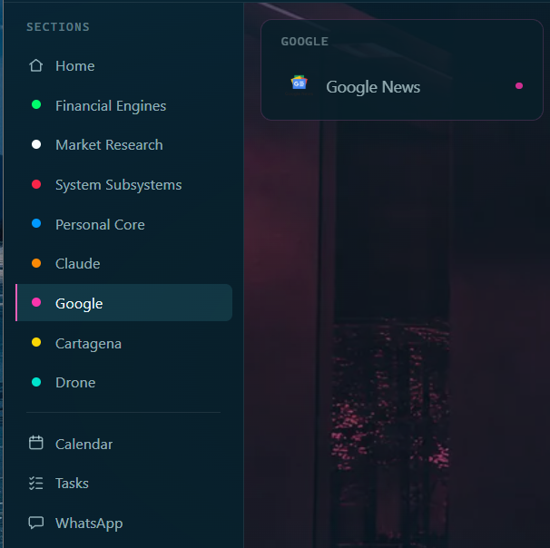
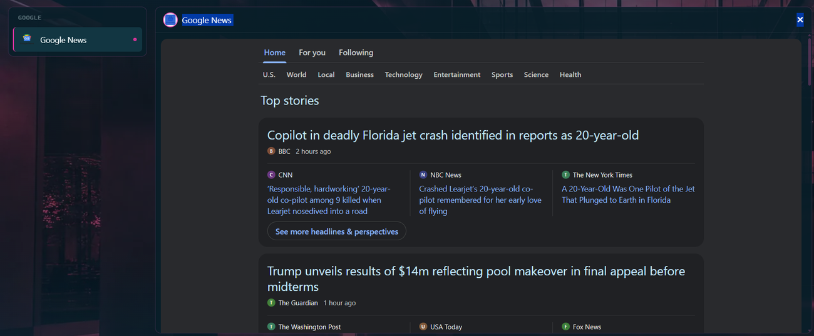

# Google News

Purpose: show you how to read Google News stories on her Google screen and how to change what you follow.
Owner: Rafiq. Version 0.4.1 (0.4.1: Following tabs corrected, 2026-11-05; 0.4.0: agreed by Rafiq 2026-11-03; 0.3.0: more pictures added 2026-11-02). Date: 2026-11-05.

The Google News card shows today's stories from Google News. It only reads. It signs in to nothing. It needs no key.

## Read the news

1. Click **Google** in the menu.
2. Click **Google News**.

**What you should see:** a card with three tabs at the top: **Home**, **For you** and **Following**. Under them are nine sections: U.S., World, Local, Business, Technology, Entertainment, Sports, Science and Health.

- **Home** shows "Top stories". Each story has a headline, its source, how long ago it came out, and a few related headlines from other papers. "See more headlines & perspectives" shows the rest.
- **For you** shows "From your topics": the newest story for each topic you follow, with the topic's name above it.
- **Following** has three tabs. **Topics & sources** lists what you follow in three groups: Topics, Local and Sources. **Saved searches** lists your searches. **Saved stories** only says they stay in your Google account.

How it went on 2026-11-02: Home, For you and Following all showed stories or your list. Following showed your Flyers, Phillies, Eagles, 76ers and DJI topics, and Cartagena under Local.

## What you follow

Your list is in one file, `data\google-news-follow.json`. She reads it each time you open the card, so a change shows at once. Git does not keep it. It was copied from the older assistant.

To follow something else, open the file in Notepad. Each topic has a name and, if you have one, an id from the end of a `news.google.com/topics/` address. A topic with a name and no id is searched by its name. Save the file.

If you turn on `google_news` in `data\config.json`, she makes this file from those answers at start-up, but only when it is missing or the answers changed. Yours is not turned on, so your file is left alone.

## Good to know

- Google answers are kept five minutes. Opening a story again right away shows the same list.
- A story's headline links to the real article.
- If one topic has no stories, the others still show.

## What is not tried yet

- Clicking a headline to see it open in a new tab.
- A section other than Home, a followed source, and a search typed in the card.
- Saved searches.
- What the card says when the laptop is offline.

If the card is empty, see **Problems and fixes**.
