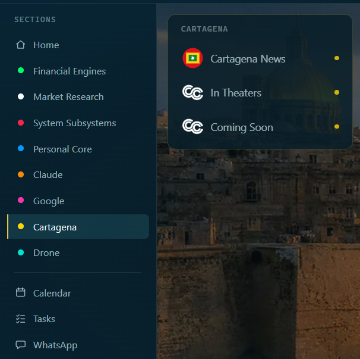
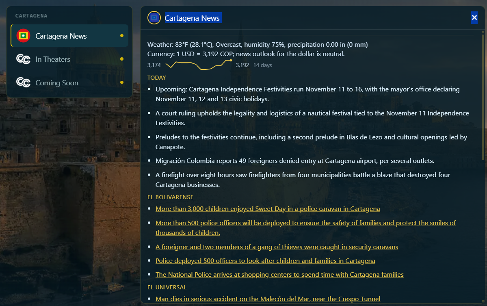

# Cartagena News

Purpose: show you what the Cartagena News card shows, and how she uses the same facts when you ask about the weather.
Owner: Rafiq. Version 0.4.0 (0.4.0: agreed by Rafiq 2026-11-03, with the not-tried list cut to two items on his word; 0.3.1: more pictures added 2026-11-02). Date: 2026-11-03.

The Cartagena News card is a morning look at Cartagena: the weather, the dollar in pesos, and the local news. It only reads. It signs in to nothing. It needs your Anthropic key, because a model translates the Spanish headlines and writes the short summary.

## Read it

1. Click **Cartagena** in the menu.
2. Click **Cartagena News**. (The other two tiles, In Theaters and Coming Soon, are the cinema pages.)

**What you should see:**

- **The weather line:** temperature in Fahrenheit and Celsius, the sky, humidity and rain.
- **The dollar line:** how many pesos one dollar buys, with a word for where the news expects it to go: up, down or neutral. A small line under it draws the last 14 days.
- **Alerts:** only a real alert, such as a water or power cut, a storm warning or a curfew. A routine traffic notice or "pico y placa" is never shown. The card shows nothing under this name when there is no alert.
- **Today:** up to five short lines, in English, with the festivals first.
- **El Bolivarense, El Universal and El Tiempo:** each paper's newest headlines in English. Each headline is a link to the real article.
- **Beyond El Centro:** things to do outside the old city, such as horseback riding, ATV tours and island trips, each with a booking link.

How it went on 2026-11-02: every part showed. The weather was 83°F and mainly clear, the dollar was neutral at 3,192 pesos, and the three papers and the list of things to do showed with links. It showed within a few seconds of the click.

## Ask her about the weather

You can ask in your own words: "What is the weather in Cartagena right now?" She answers from the same facts, in one to three short sentences. Her rules say she must not bring up Cartagena by herself, except to warn you of an urgent emergency such as a hurricane alert or a big water shutdown, and that her hello must not include the weather, because it is on the screen. Neither has been heard yet.

On 2026-11-02 she answered from the card: 28.6°C, feels like 33°C, mainly clear, humidity 72%. She spoke in metric, because this laptop's units setting was empty. It is now set to imperial, so the next answer should say Fahrenheit. That has not been heard yet.

## Good to know

- The weather and the dollar are kept 15 minutes, and the papers' pages one hour. She is set to read them once when she starts, so your first question is quick. That start-up read was not seen in the log.
- El Universal, El Tiempo and the things-to-do list are read in her hidden Chrome window. El Bolivarense comes from its feed. It opens by itself when needed and closes after five idle minutes. It does not need a sign-in for these.
- A headline older than its date, or one that could not be turned into English, is left out.
- If one source fails, the others still show.
- Things to do are read about once a week.

Rafiq saw a headline open when he clicked it, and heard her answer in Spanish when he asked in Spanish (his word, 2026-11-03).

## What is not tried yet

- A day with a real alert, or a storm warning.
- What the Cartagena News card shows when the laptop has no internet.

If the card is empty, see **Problems and fixes**.
