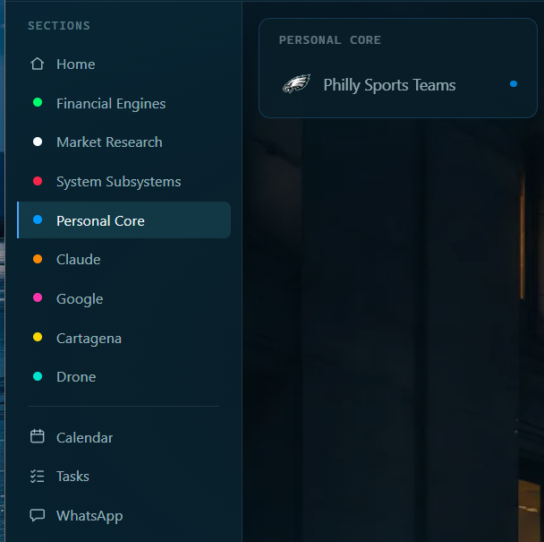
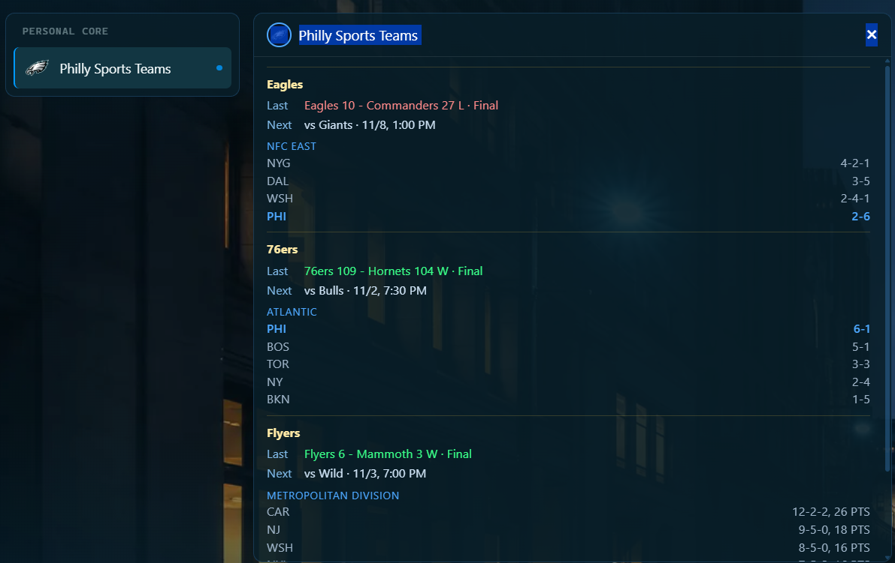

# Philly sports

Purpose: show you what the Philly Sports Teams card shows and when a team appears on it.
Owner: Rafiq. Version 0.4.1 (0.4.1: the clock time dropped from the example, a line added for when no team shows, 2026-11-05; 0.4.0: agreed by Rafiq 2026-11-03, with the live game moved to seen on his word; 0.3.0: more pictures added 2026-11-02). Date: 2026-11-05.

The card follows your Philadelphia teams: the Eagles, Phillies, 76ers, Flyers and Union. It only reads. It needs no key and no sign-in. The scores come from ESPN's public pages.

## Read it

1. Click **Personal Core** in the menu.
2. Click **Philly Sports Teams**.

**What you should see:** one block for each team that is in play. Each block has:

- **Last:** the last game, with the score and W or L, or the live score while a game is on.
- **Next:** the next game, with its date and local start time.
- **The division table:** the team's division, with records, and your team's row highlighted.

**When a team shows.** A team shows only while a game is on, or while its next game is within 14 days. Past results alone never keep a team on the card. So in the off season a team is hidden, and it comes back about two weeks before its first game. If no team shows, the card says "No Philadelphia team has a game in progress or in the next 14 days." The Union, the soccer team, hides quietly when ESPN has nothing for it. For any other team that cannot be read, the card shows a short error line instead of hiding it.

How it went on 2026-11-02: three teams showed. The Eagles' last game was a 27 to 10 loss to the Commanders, and their next is the Giants on 11/8. The 76ers' last was a 109 to 104 win at the Hornets, and the Flyers' last was a 6 to 3 win over the Mammoth. The Phillies and the Union were hidden, because neither had a game within 14 days.

## Good to know

- The answer is kept one minute. Open the card again after a minute to see a new score.
- Times are shown in this laptop's own time.
- If one team cannot be read, the others still show.

Rafiq saw the live score and the game clock on the card during a real game (his word, 2026-11-03).

## What is not tried yet

- A team with an error line. This is a short line in a team's block, "Schedule unavailable." or "Could not load this team.", shown when ESPN cannot be read for that team. It has not happened yet.
- What the Philly Sports Teams card shows when the laptop has no internet.

If the card is empty or shows an error, see **Problems and fixes**.
