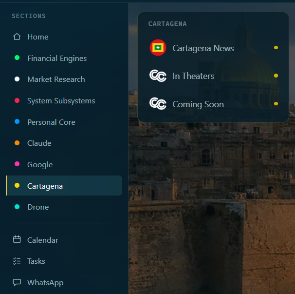
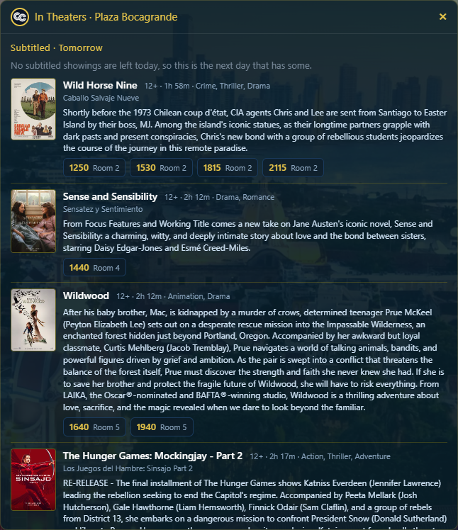
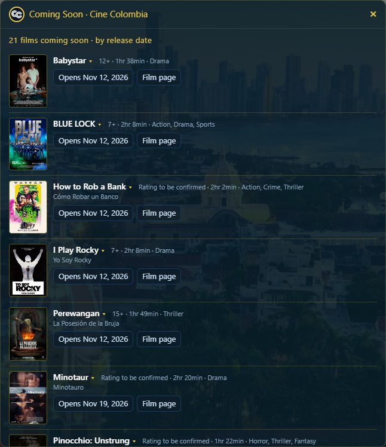

# In Theaters and Coming Soon

Purpose: show you what the two cinema cards show, and what to do when Coming Soon is blank the first time.
Owner: Rafiq. Version 0.5.2 (0.5.2: a time goes straight to its seat page again, CL-083; 0.5.1: a time links to its film's page, CL-082; 0.5.0: the cinema's redesigned site, CL-081, 2026-11-09; 0.4.1: the robot-check and empty-page notes added, 2026-11-06; 0.4.0: agreed by Rafiq 2026-11-03, with the not-tried list cut to two items on his word; 0.3.3: seating chart wording). Date: 2026-11-06.

Two cards in the Cartagena section read the Cine Colombia website: **In Theaters** (what is playing at Plaza Bocagrande) and **Coming Soon** (films that open soon). They only read. They sign in to nothing and buy nothing. Both are read in her hidden Chrome window, which opens by itself and closes after five idle minutes. The film titles and synopses are put into English by a model, so they need your Anthropic key.

## In Theaters

1. Click **Cartagena** in the menu.
2. Click **In Theaters**.

**What you should see:** a card headed "In Theaters · Plaza Bocagrande" and "Subtitled · Today". Each film has its poster, its title (with the Spanish title under it when the site gives one), its rating, running time and genre, a short English synopsis, and its showtimes with the room. A showtime is a link. Click a time and the cinema's own seating chart for that showing opens in a new tab, so you can choose seats. (The cinema's redesign of 2026-11-09 hid those addresses; she now reads each showing's number from the showings the cinema's page itself loads. If a number is ever missing, that time opens its film's page on the cinema's site instead, and you pick the time again there.) Only showings that have subtitles and have not started yet are listed. When none are left today, the card shows the next day that has some, up to six days, counting today.

How it went on 2026-11-02: the first read worked and showed the films with posters and showtimes, in about ten seconds.

## Coming Soon

1. Click **Cartagena**, then **Coming Soon**.
2. Wait. The card says "Reading the CineColombia page... the first read can take up to two minutes."

**What you should see:** "N films coming soon · by release date". Each film has its poster, rating and genres, an "Opens" date and a "Film page" link. Only films in the chosen genres are listed: Adventure, Drama, Action, Sci-Fi, Horror, Comedy, Thriller, Mystery and Crime. If the site's filter does not apply, she shows nothing rather than an unfiltered list.

How it went on 2026-11-02: the first try said "Could not read the CineColombia page." The second try, about two minutes later, showed "23 films coming soon" with posters, ratings, genres, dates and links.

## If Coming Soon says it could not read the page

The first time her hidden window visits the Cine Colombia site, the site can send a blank page. She now tries a second time by herself after a few seconds, so this should seldom reach you. If both tries fail, the card says "Could not read the CineColombia page." Click **Coming Soon** again after a minute. If it keeps failing, see **Problems and fixes**. Sometimes the cinema site shows its robot check, or sends an empty page. Then the card says so in plain words: "The cinema site is asking for a robot check, so its page cannot be read right now," or "The cinema site answered with an empty page, so nothing can be read right now. It is most likely the robot check; try again in a few minutes." She never tries to get past a robot check. It comes and goes: on 2026-11-06 the cards failed at 1938 and worked at 2002.

The second try was tested with a stand-in. It has not yet been seen on a real blank first page.

## Good to know

- A result is kept 30 minutes for In Theaters and an hour for Coming Soon. It is dropped sooner when its first showing starts.
- Only one read runs at a time, and at least 20 seconds pass between reads. A click inside that time says "A check is already running." or "Please wait a moment before checking again."
- If a poster picture cannot be fetched, that film shows without one.
- Her hidden window can show the cookie banner; she never accepts it.

Rafiq saw a click on a showtime and a click on a film page link work, and saw a first read of Coming Soon work the first time (his word, 2026-11-03).

## What is not tried yet

- A day with no subtitled showing left (the next-day card). Rafiq says this does not happen, so it has not been seen.
- What the In Theaters and Coming Soon cards show when the laptop has no internet.
