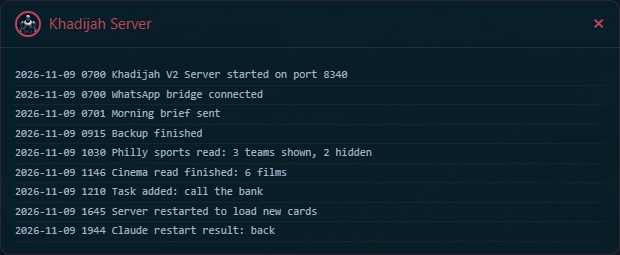
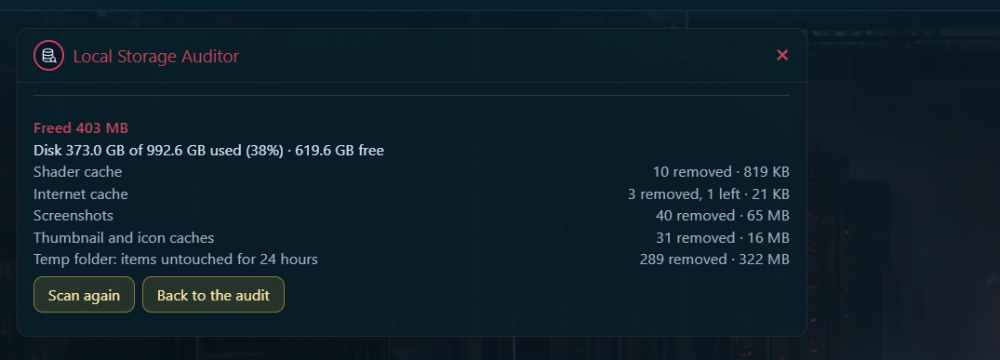
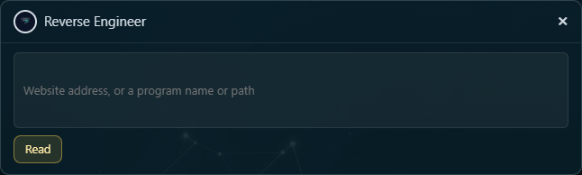
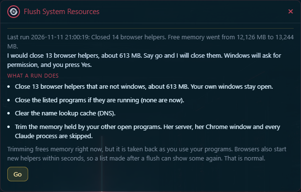
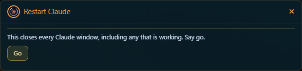
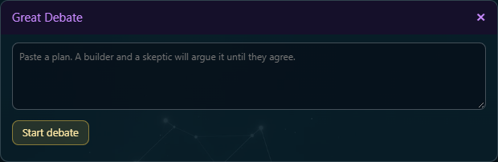
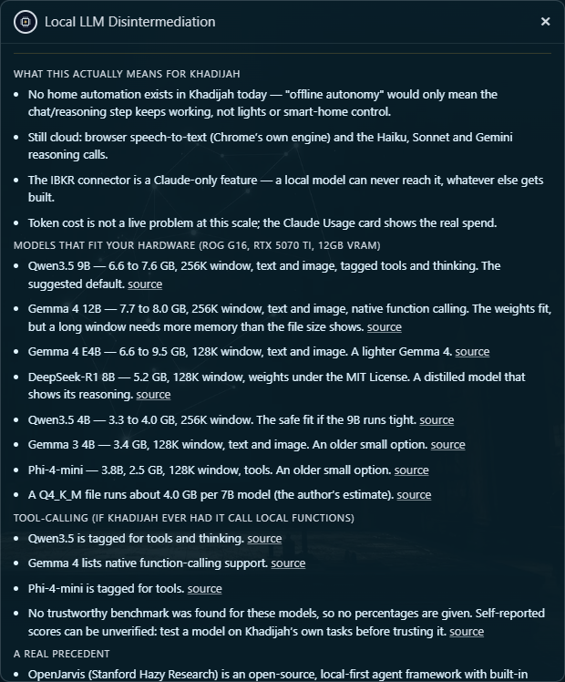
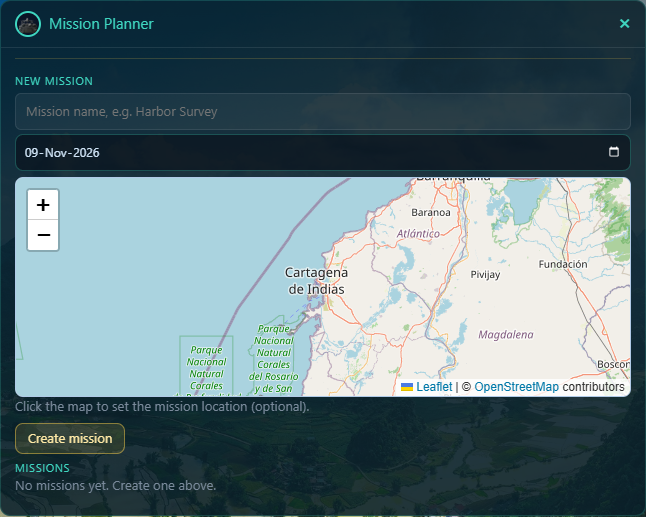
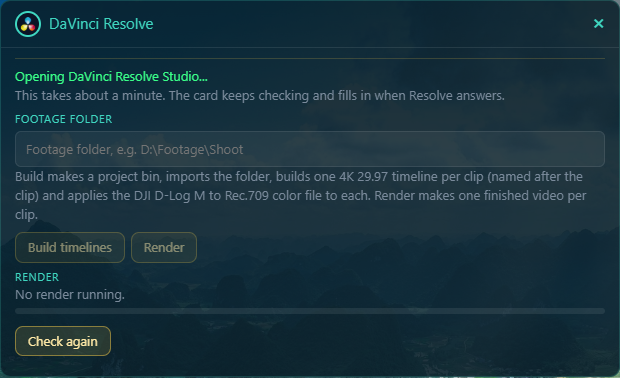

# The machine and creative parts

Purpose: tell you what the Server Info, Storage, Network, battery, patch, screen, Reverse Engineer, Flush System Resources, Restart Claude, Mission Planner, Resolve, Local LLM and Great Debate parts do, and what each one will not do without you.
Owner: Rafiq. Version 0.8.6 (0.8.6: the Network Doctor part says the card only looks and the fix commands are typed, CL-108, 2026-11-12; 0.8.5: 0.8.5: the Network Doctor part describes the labelled parts, the chosen weekly check and alerts, the tool line and the hold, with a new picture, 2026-11-12; 0.8.4: Flush shows each step and a result panel, 2026-11-11; 0.8.3: pictures for Server Info, Reverse Engineer, Flush System Resources, Restart Claude, Great Debate, Local LLM, Mission Planner and Resolve, 2026-11-09; 0.8.2: Reverse Engineer reads programs and apps; Flush System Resources and Restart Claude added, 2026-11-09; 0.8.1: the WhatsApp patch message is on, the Local LLM tile name, 2026-11-05; 0.8.0: the Node.js rules and the first real runs, 2026-11-04; 0.7.0: the update path built by CL-051, agreed by Rafiq 2026-11-03; 0.6.0 agreed 2026-11-03; 0.6.0: Server Info added to the purpose line, Local LLM added to a heading, Security patches now says she installs nothing and nothing tells you, a render note dropped from Not tried yet; 0.5.2: the folder Resolve's files go in; 0.5.1: the Mavic 4 Pro render seen, 2026-11-03; 0.5.0: Mission Planner corrected to the built flight planner, Resolve made its own part with Rafiq's Mavic 4 Pro render settings, 2026-11-03; 0.4.1: Server Info section added; 0.4.0: the Local LLM node added, 2026-11-03; 0.3.0: Mission Planner and Resolve steps added after a real run). Date: 2026-11-12.

Most of these only read. The few that can change something ask you first.

## Server Info

Open **System Subsystems**, then **Khadijah Server Info**. The card shows the end of her server's log: one line for each thing the server did, each with the date and time. Use it to see that she is working, or to see what happened just before a fault. You can also say "open server info". The same lines are kept in the log file. See **Where she keeps things**.

On 2026-11-03 the log lines were read through the server and showed page requests, speech pieces and health checks. The card itself was not opened in a browser for this page.

## Storage

Open **System Subsystems**, then **Local Storage Auditor**. The top shows the disk used and free, and your Screenshots folder. Nothing else is listed.

Press **Scan for junk** to see what could go. A scan only looks and deletes nothing. Each item shows its size.

- **Ticked at the start:** in Windows junk, the shader cache, the internet cache, thumbnail and icon caches, error reports and Temp files untouched for 24 hours; every folder from the rules file in App and developer caches; and every broken Desktop or Start Menu shortcut (a shortcut whose target is gone) in Broken shortcuts.
- **Not ticked:** the Recycle Bin, crash dumps, your Screenshots and the Resolve cache. You tick those yourself.
- **App caches:** only folders named in `conf\cleaner-rules.json` are offered, and never a browser's sign-ins, settings or the hidden browser's profile.
- **Resolve cache:** offered only while Resolve is closed, and only when the rules file names a folder called `CacheClip` as `resolve_cache`.

**Nothing else is needed to approve a clean.** Tick the items you want, press **Clean ticked items**, then press **Delete n items permanently**. Your ticks and that press are the approval. A clean is permanent: it does not go to the Recycle Bin.

When it finishes, the card says how much space it freed and lists what it removed from each item. On 2026-11-02 the first real clean freed 403 MB.

## Network

**Network Mapper** lists the devices on your Wi-Fi and marks any she does not recognise. Press **Rescan** to look again. On 2026-11-02 it found 8 devices, all recognised. A phone that uses a private Wi-Fi address looks new until you trust it.

**Network Doctor** checks your connection and tells you in plain words what is wrong and what to check first. Click **Network Doctor** and wait about 35 seconds. It starts with a verdict, Good, Watch or Bad, and one plain sentence. If the drops tend to start at the same time each day, a note right under the verdict says so, for example "Drops often start around 2000".

The card has up to three parts, each with its own label:

- **On demand: right now** is always there. It shows your speed down and up, the reply time to the internet and how many packets were lost, each with one plain sentence. A line under the speed says which tool measured it, Ookla Speedtest or Cloudflare. If the speed test could not run, the speed says Not measured and gives the reason.
- **Weekly check** shows the last weekly speed checks (date, speed down and up, reply time). It is there only if you chose the weekly check when you installed Network Doctor.
- **Alerts** shows the latest alerts, newest first. It is there only if you chose alerts when you installed it.

Under "Over the past week" it also shows how many times the connection dropped and how many devices it does not know. Press **Check again** to run it again. A speed test is not repeated for a couple of minutes (2 minutes with Ookla, 10 with Cloudflare): if you press too soon, the card says "Too soon to test again", how old the last reading is and when to come back. The card only looks. It never changes a setting. The Network Doctor program also has fix commands. They run only when you type them in a window and say yes, and this card has no fix button.

Network Doctor is its own program. If it is not on this laptop, the card says so and nothing else happens.

## Batteries

Once, a little after she starts, she asks Windows for the battery of your Bluetooth devices. A device at 20 percent or lower shows as a red moon on her globe. On 2026-11-02 the keyboard was at 20 percent.

## Security patches

Once a week she checks Node.js and your Python packages for security updates. It finds them, and she installs the safe ones herself. Here is what she does.

- **Node.js:** she asks Windows' package tool (winget) which version you have and which is newest.
- **Python packages:** she runs a tool called pip-audit. It compares your packages with public lists of known security holes and names the version that fixes each one.

You can also ask her out loud or by typing: "Check for security patches". Every check is saved in `data\patch-check-history.json` (the last 20).

**When a Python fix is found, she does this, in order:**

1. She saves the list of every package and its version, in `data\patch-snapshots`.
2. She picks the smallest version that fixes the problem.
3. She checks every other package that needs it. If any of them forbids the new version, she installs nothing and tells you which one.
4. She installs it, checks that all the packages still agree with each other, and runs all of her own tests.
5. If anything fails, she puts every saved version back and tells you she did.

**Node.js:** she installs a newer version, even a big jump (24 to 26), unless a part she depends on says it cannot work with it. If a part says that, she installs nothing and tells you which part. Windows' Node.js installer shuts her down while it works, so she hands the job to a small helper program. The helper turns her off, installs, checks that WhatsApp still works, and turns her back on by itself. Her page opens again in Chrome. On 2026-11-04 this took about six minutes, almost all of it Windows' installer. If WhatsApp stops working with the new Node.js, the helper takes it off, puts your old one back, and tells you.

**How you find out:** she says it aloud and writes it in the event log the next time she is quiet, or the next time you open her if she was closed. It is also in the saved results. When a check finds something, she also sends it by WhatsApp, to the same place as the morning brief. That message has not been seen yet.

**What has run for real, and what has not.** On 2026-11-04 a real Python update (`pip`) and a real Node.js update (24.22.1 to 26.13.0) ran, and the helper turned her off and on again by itself. Not run for real: putting the old Node.js back after a failed update (it would take Node.js off your laptop), and her saying the update news aloud. On 2026-11-03 a real dry run found `cryptography` blocked, because the Webull program needs the older one. To stop her installing anything, set `PATCH_AUTO_UPDATE` to `False` in `settings.py`.

On 2026-11-02 she said Node.js had a newer version and two Python packages needed updates.

## Looking at your screen

She never looks without asking. If you ask what is on your screen, she asks which screen first. Say the screen, "all", or "no". A "no" captures nothing. Only your own words count as an answer. A look sends a picture of that screen to the AI, so close anything private first. **Never let her look while your broker or Claude Usage pages are open.** On 2026-11-02 she asked which screen, the answer was "laptop screen", and she described the desktop (its wallpaper and icons) in about five seconds.

## Reverse Engineer

Open the Reverse Engineer card, type a website address or the name of a program or app, and press Read. You can also say "Reverse engineer" and then the name. A website address is read as a website. Anything else is read as a program or app.

**A website.** She reads the page in her own Chrome window, lists how it is built, and also lists the scripts the page loads. She saves a note in `data\notes\teardowns`. She cannot see the backend, and says so.

**A program or app.** She looks for the file on this laptop (Downloads, Desktop, the tools folder, Documents and Program Files) and tells you which file she picked. A full path also works. The real Reverse Engineer tool then reads it. It lists the size, what the program asks Windows for, and its start routine. She never runs the program. A read takes about a minute. The full report is saved in `C:\Users\you\Downloads\Claude finished work\Reverse Engineer reports`.

She reads one thing at a time. If she cannot find a program by name, she says so and asks for the path.

## Flush System Resources

Open the Flush System Resources card, or say "Flush system resources". She first lists what she would close and how much memory that frees. She closes nothing yet. The list comes from `conf\flush-programs.txt`, one name per line, and you can edit it. She never closes Claude, her own server, her WhatsApp bridge or her Chrome window, even if they are on the list.

Press Go on the card, or say "go". Windows then asks for permission. Press Yes on the screen. She waits up to 5 minutes for you. If you do not press Yes, or you press No, nothing is closed. When it is done she tells you what closed and your free memory before and after. She will not run while she is reading a page.

The card also tells you what is going on. Before Go it lists the four steps a run takes: close the browser helpers, close the listed programs, clear the name lookup cache, and trim the memory of your other open programs. It adds one note: trimmed memory is taken back as you use your programs, and browsers start new helpers within seconds, so a list made right after a flush can show some again. That is normal. After a run, press **How much came back?** to see your free memory now next to the numbers from before and right after the run. The top of the card shows the last run, and each run is also written to her log (`Flush run:`).

You can watch a run as it goes. After you press Go, the card first says it is waiting for you to press Yes. Then each step gets a check mark as it finishes, with what it did, and the next step shows three dots. When the run ends, a panel called **What this run did** appears. Its top line says whether it worked and how much memory is free now. Below it are the four steps and what each one did, then your free memory before, after, and gained. If free memory did not go up, the line says it finished and does not say it worked. If the page loses its connection during the run, the card finds the saved result and shows the same panel. The panel is also kept as part of the last run.

## Restart Claude

Open the Restart Claude card, or say "Restart Claude". She asks first: this closes every Claude window, including any that is working. Press Go, or say "go". She closes Claude and opens it again. About a minute later she tells you whether Claude is open again. Every Claude session stays saved. Open one again from the sidebar.

## Missions, Resolve, Local LLM and the Great Debate

- **Mission Planner** (Drone group) plans a flight ahead of time for your DJI Mavic 4 Pro and makes the flight file for the controller. It also moves drone footage into one folder per mission. Nothing is deleted. It never writes to the controller.
- **DaVinci Resolve Studio** (Drone group) is its own card. Opening it starts Resolve Studio if it is closed. That takes about a minute. She never starts it for a spoken command, and never closes it. It builds your timelines and renders them with your Mavic 4 Pro preset. See "DaVinci Resolve Studio" below.
- **LLM** (Market Research group; the card is titled Local LLM Disintermediation) is a short report on running an AI model on your own laptop, with a button that looks for new items on eight public sites. See "The Local LLM node" below.
- **Great Debate** (Market Research group) has two voices argue a strategy for several rounds and agree one. It uses the AI and costs a few calls each time.

## The Local LLM node

This is a short report on running an AI model on your own laptop instead of in the cloud. The top part is written by hand and does not change. Each fact has a "source" link to the page it came from. It was checked on 2026-11-03. The sizes in it are the ones that fit your 12 GB of video memory.

To see what is new:

1. Open the Local LLM node.
2. Scroll to the bottom and press **Check for new items**.
3. Wait a few seconds. She reads eight public sites: Interconnects, the Hugging Face blog, the Ollama blog, Ollama releases, llama.cpp releases, Mistral news, OpenJarvis releases and r/LocalLLaMA.
4. Each site shows its three newest items with the date. Click a title to open it in a new tab.

She looks only when you press the button. If you press it again within 15 minutes, she shows the last result. If one site is down, that site shows a note and the others still show. The button never changes the report above it, and she sends nothing about you.

## Mission Planner, step by step

Mission Planner is for your drone. It has nothing to do with Resolve.

**Plan a flight**

1. Open **Drone**, then **Mission Planner**.
2. Type a mission name. Check the date. Click the map where you will fly. The point is optional. Press **Create mission**. The mission appears in the list, open.
3. In the **Flight planner (Mavic 4 Pro)**, press **Add waypoints: OFF** so it reads ON. Click the map once for each waypoint, in order. Drag a numbered dot to move it.
4. To change many waypoints at once, select them (hold Shift or Ctrl to pick more than one). Fill in what you want to change: height in feet, speed in mph, heading, turn, camera tilt, camera action, or stay in seconds. A blank box is left alone. Press **Apply to selected**.
5. Under **This flight**, choose what happens at the end, and what happens if the signal is lost.
6. Read the **Report**. It shows the distance in miles, the time, and every problem it found. It fixes nothing by itself. A height over 400 feet is a warning, not a refusal.
7. Press **Save flights**. Nothing is kept until you do.
8. Press **Export files**. It writes one file for each flight in `Missions\<date>\<mission name>\Flights`. It never overwrites a file. A name already taken gets a number added.

**The limits.** A flight holds at most 50 waypoints. If your path is longer, press **Split into flights of 50**. Each new flight starts where the last one ended. Speed is above 0 and at most 33 mph. Waypoints are 2 feet to 6,560 feet apart. If a flight breaks a rule, Save refuses it and tells you why.

**Put the file on your controller.** Khadijah never writes to the controller. You do it yourself. After Export she lists the steps. In short: back up the controller's mission folder first, make a throwaway waypoint mission in DJI Fly, copy the new file over it using the same name, then open it in DJI Fly and check every waypoint on the map before you fly.

**File your footage**

1. Type the folder that holds your photos and videos. Press **Import**. This only looks. A photo with a place matches when it was taken within 31 miles of your point and within three days of the mission date. A photo with no place, and every video, matches on the date alone.
2. Read the list. Press **Confirm: move matched files** twice. The files move into `Missions\<date>\<mission name>`, in `Photos` and `Video`. A name already taken gets a number added. Files that did not match stay where they were.

**What was done for real.** On 2026-11-02: the map click, a path, a photo matched by place, a photo matched by date, and a photo 2,052 miles away that was refused. On 2026-11-03: four waypoints placed, one edit applied (150 feet, set angle 90, take photo), a report of 0.222 miles and about 0.9 minutes, and one flight file written. Save refused an old test path whose points were 19,843 feet apart, and said why.

**Not tried yet.** Moving a waypoint by dragging, points of interest, Insert after, splitting a long path, exporting more than one flight, and putting a file on your controller.

## DaVinci Resolve Studio

This is its own card. It has no button in Mission Planner.

1. Open the **DaVinci Resolve Studio** card. It starts Resolve Studio if it is closed. That takes about a minute. Wait until the card shows a version. If it does not, press **Check again**.
2. Type the **Footage folder**. Press **Build timelines**, then **Confirm**. It makes the project "Khadijah" and one 4K timeline for each clip, and puts your color file on them.
3. Press **Render**, then **Confirm**. A render needs the name of a render preset from Resolve.

**How you render: your Mavic 4 Pro preset.** This is the preset you use for the Mavic 4 Pro, and the one she is to render with:

| Setting | Value |
|---|---|
| Preset name | Mavic 4 Pro |
| File type | MP4 |
| Codec | H.265 |
| Size | 6016 by 3384 (custom) |
| Frame rate | The timeline's frame rate (29.97 frames a second) |
| Rate control | Variable bitrate, quality Best |

Put the name in `config.json` as `resolve_render_preset`: `"resolve_render_preset": "Mavic 4 Pro"`. It is saved there now. A render with it was run on 2026-11-03 and made an MP4, H.265, 6016 by 3384, 29.97 frames a second. You played it on 2026-11-03 and it plays well. If the name is blank or misspelled, a render stops and lists the presets Resolve has.

**Where the files go.** Your finished videos always go in `C:\Users\you\Media to work on\Davinci`. Only the finished video goes there; the project and the clips stay where they are.

If Resolve is closed, she waits about ten seconds and then says so.

**What was done for real.** On 2026-11-02 she built the project "Khadijah" and one timeline named after the clip, and applied the color file. The render that ran that day used Resolve's own "H.264 Master" preset, which is not yours.

## Not tried yet

- The weekly patch check's WhatsApp message (on since 2026-11-04; the first one is due 2026-11-09).
- Importing a drone card with many files, and a photo with a place on a real drone (the one test clip has none).
- A flight file on your controller.

If something here does not work, see **Problems and fixes**.
